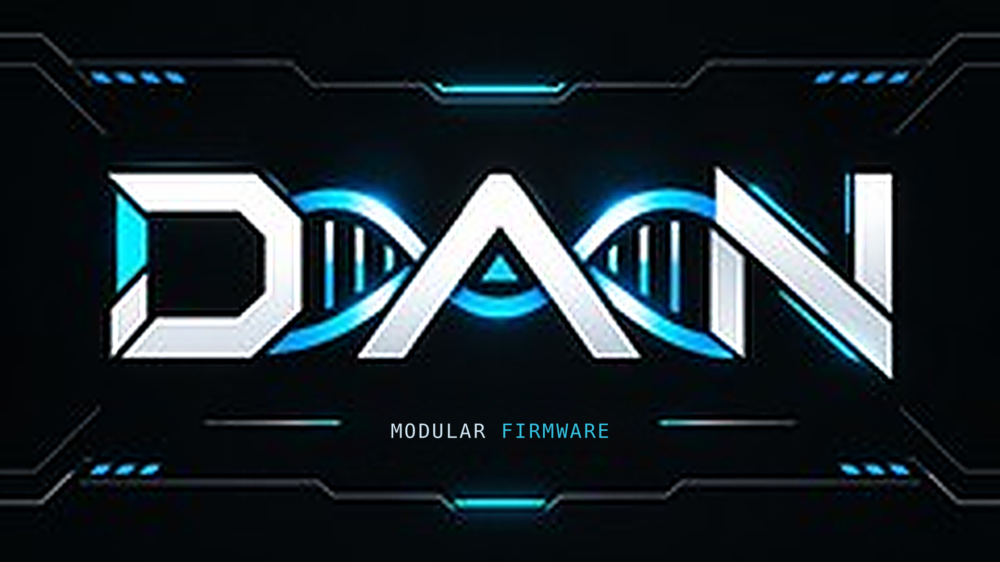

  

<h1 align="center">DAN · Modular Firmware</h1>

  <strong>Don't Ask Now.</strong> One modular firmware platform. Shared Core, portable Apps and board-specific backends.

  
  
  

  <a href="#hardware-backends">Hardware backends</a> ·
  <a href="#how-dan-is-organized">Architecture</a> ·
  <a href="#project-status">Project status</a>

---

## The idea

**DAN** is a modular firmware project for compact, self-contained wireless diagnostics and authorized hardware testing. It separates reusable Apps and services from the code that controls a particular board's screen, keys, storage and radios.

The platform name stays **DAN — Modular Firmware**. A device-specific implementation uses a backend designation such as **DAN-ADV**, rather than redefining the DAN brand for every board. **The long-term architecture is one shared codebase with multiple hardware backends, not a separate permanent repository for every device.**

## Hardware backends

| Backend | Target hardware | Current project status |
| :--- | :--- | :--- |
| **[DAN-ADV](https://github.com/5wvjywt4w2-sys/DAN-ADV)** | M5Stack Cardputer ADV | Active private Core 1 reference implementation, hosting the shared platform during development. |
| **DAN / T-Embed backend** | LILYGO T-Embed CC1101 Plus | Tested device-specific work exists in an earlier porting repository; integration into the shared DAN codebase is **planned, not complete**. |
| **Future board backends** | Additional compatible hardware | Intended to live alongside other backends in the unified project as each is implemented and validated. |

> **Repository access:** Current firmware repositories are private; visitors without permission may see a 404 when following a link. The older T-Embed development repository is a **temporary migration source**, not a planned permanent fork. No public firmware build or release is being offered here.

## How DAN is organized

| Layer | Responsibility |
| :--- | :--- |
| **Core** | App lifecycle, navigation, system state and shared behavior. |
| **Hardware Services / HAL** | Approved access to radios and peripherals, resource ownership and safety boundaries. |
| **Apps** | Device-aware capabilities through a portable contract, where supported. |
| **Backends** | Board-specific display, controls, drivers, radio wiring and deployment. |

The intended unified repository will share Core, HAL contracts and portable Apps, while keeping **display, controls, peripheral drivers, pin mappings and board-specific configuration** behind separate backends. Previously tested T-Embed work will be carried across only after compatibility and regression checks. The old port repository can be retired **after** the integrated backend is validated.

A feature validated on one board is **not** automatically available, tested or released on another.

## Project status

DAN is being developed with an emphasis on **practical hardware validation**, modularity, observable diagnostics and clear separation between implemented features and planned work. Public-facing descriptions are not release announcements or guarantees of support on every device.

**Intended use:** Owned systems, authorized assessment and controlled laboratory research, within applicable safety and radio regulations.

---

DAN · Don't Ask Now · Modular Firmware
